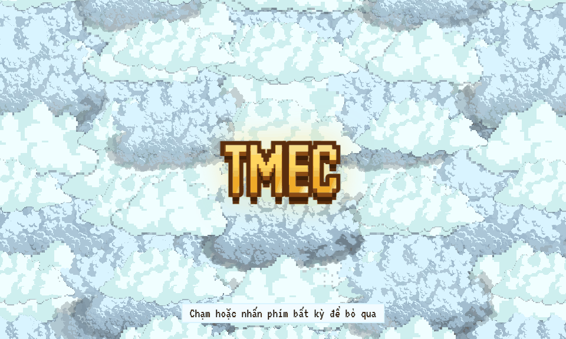
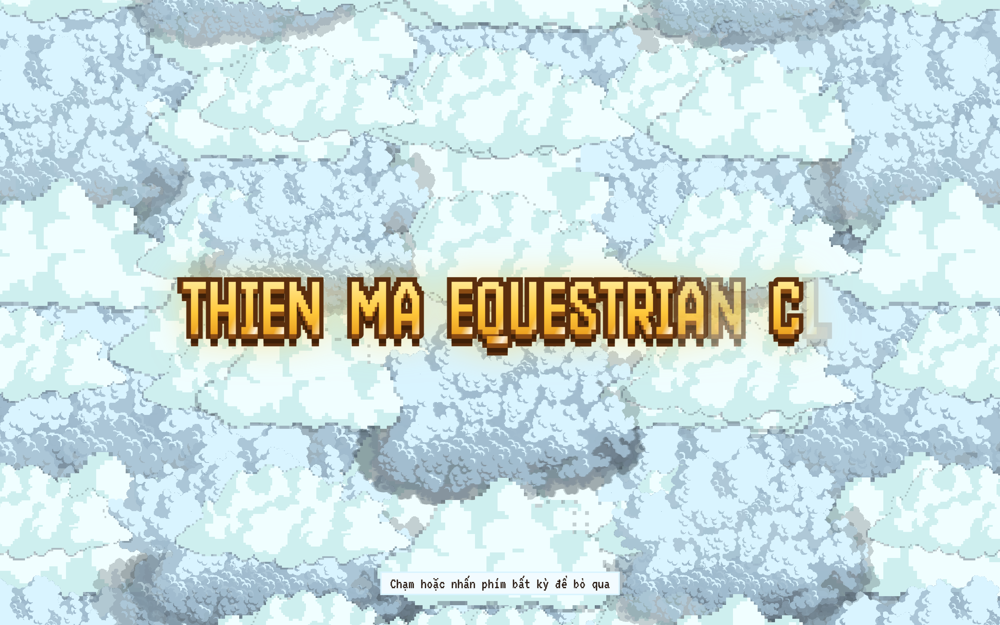

# 🐎 EquiFlow Simulator Web — Phiên Bản 3 (v3: TMEC Intro & Bố Cục Mới)

[](https://github.com/MichaelTran1226/Racehorse_Simulator_Web/tree/v3-tmec-intro)
[](https://github.com/MichaelTran1226/Racehorse_Simulator_Web/tree/v3-tmec-intro)
[](https://github.com/MichaelTran1226/Racehorse_Simulator_Web)
[](https://github.com/MichaelTran1226/Racehorse_Simulator_Web)
[](http://localhost:5175)

> **Phân hệ Digital Twin / IoT Ảo theo SRS & Design Handoff v2.0** (`horse simulation model/`).  
> Ứng dụng web độc lập, đồ họa **Pixel Art trên HTML5 Canvas 2D phong cách Stardew Valley**, kết hợp giao diện tương tác **Hay Day** thân thiện với người dùng.  
> Tích hợp màn hiệu ứng mở màn thương hiệu **TMEC Intro (Thien Ma Equestrian Club)**, bản đồ nông trại bố cục mới, động cơ mô phỏng sinh trắc học ngựa (Telemetry Math Engine), quản lý kho vật tư, khu chuồng trại, trạm thú y và trường đua kịch tính.

---

## 🌟 Điểm Nâng Cấp Nổi Bật của Phiên Bản 3 (v3 vs v2)

1. **🎬 Màn Mở Màn Thương Hiệu (TMEC Intro Overlay):**
   - 3 lớp mây Stardew (`back`, `mid`, `front`) phủ kín màn hình tạo chiều sâu parallax.
   - Chữ viết tắt **"TMEC"** bật nảy ở trung tâm rồi giãn mượt mà thành tên câu lạc bộ: **"THIEN MA EQUESTRIAN CLUB"**.
   - Mây tách dần sang hai bên, camera lướt nhẹ từ tỉ lệ `1.06` về `1.0` đưa người dùng vào trung tâm nông trại (thời lượng 4.2 giây, hỗ trợ bấm phím/chạm để bỏ qua hoặc tự động chuyển mờ dần khi bật `prefers-reduced-motion`).
2. **🗺️ Quy Hoạch Bản Đồ Nông Trại Mới:**
   - **Đường xe hàng xuyên tâm:** Đường đất 3 ô chạy thẳng từ mép trái, băng qua trước cửa Kho vật tư đến mép phải bản đồ. Xe tải giao hàng chạy thẳng mạch lạc.
   - **Trạm Y Tế đối xứng:** Sprite trạm thú y được tái cấu trúc đối xứng hai bên (`art/aseprite/patch-clinic.lua`).
   - **Không gian sinh thái:** Hai vườn cảnh hoa cỏ ở phía tây, bãi tập huấn luyện cát hướng đông bắc, loại bỏ vùng nước ao/sông để tập trung không gian cho vận động ngựa.
   - **Tọa độ tâm nhìn (Main Focus):** Khi vừa mở màn, camera định vị chuẩn xác vào điểm giao giữa 4 công trình trọng điểm.
3. **🧪 Bộ Kiểm Thử Mở Rộng:** Tăng cường từ 79 bài test lên **92/92 bài kiểm thử tự động đạt 100% (PASS)**, bao gồm kiểm tra nhịp thời gian intro, autotile đường xe hàng và tính toàn vẹn byte của các sprite mới.

---

## 🎬 Hoạt Cảnh Chuyển Động & Hiệu Ứng Mở Màn (Showcase Animation)

<p align="center">
  
  <br />
  <em>Màn Intro TMEC nảy chữ thương hiệu kết hợp chuyển cảnh vào trang trại Stardew Valley sống động</em>
</p>

---

## 📸 Bộ Ảnh Snapshot Thực Tế Các Phân Cảnh (v3 Visual Showcase)

### 1. Mở Màn Thương Hiệu TMEC & Toàn Cảnh Trang Trại (Ngày & Đêm)

| ☁️ Màn Intro TMEC (Mây Parallax) | ☀ Toàn cảnh Ban ngày (Day Mode) | ☾ Ánh đèn Ban đêm (Night Mode) |
|:---:|:---:|:---:|
|  |  |  |
| *Mây 3 tầng tách đôi, chữ TMEC nảy nở* | *Bố cục v3: đường xe chạy thẳng, 2 Barns, vườn hoa tây* | *Ánh đèn vàng hắt từ khung cửa gỗ, đom đóm lập lòe* |

---

### 2. Quản Lý Đàn Ngựa & Thẻ Sinh Trắc Học (Telemetry)
Chạm trực tiếp vào bất kỳ chú ngựa nào trên bãi cỏ hoặc bấm nút tròn **♞ Ngựa** ở góc phải dưới để mở bảng danh mục đàn ngựa và thẻ chiến mã chi tiết.

| 📋 Danh sách đàn ngựa (Horse Roster) | 🩺 Thẻ Telemetry chi tiết (Horse Card) |
|:---:|:---:|
|  |  |
| *Lưới thẻ chiến mã pixel art, tình trạng sức khỏe (Đủ điều kiện, Cần theo dõi, Khóa)* | *Chân dung hoạt ảnh, thanh đo nhịp tim (BPM) 3 dải màu, thể lực, tốc độ km/h, mã chip 15 số ISO 11784 và nút gạt Khóa y tế* |

---

### 3. Khu Chuồng Trại & Trạm Khám Thú Y (Stalls & Vet Clinic)
Bấm vào công trình trên bản đồ: camera lướt mượt mà tới vị trí công trình và mở bảng nổi gỗ phong cách Hay Day.

| 🏠 Khu chuồng trại (6×6 Stalls Grid) | 🏥 Trạm khám thú y (Vet Clinic) |
|:---:|:---:|
|  |  |
| *Phân bổ ngựa vào các ô chuồng; mã màu phân loại thể trạng; ngựa nghỉ ngơi có bong bóng "zzz"* | *Trạm thú y đối xứng, khu cách ly theo dõi chấn thương, bảng cảnh báo sự cố thời gian thực* |

---

### 4. Kho Vật Tư & Xe Giao Hàng Tận Nơi (Supply Barn)
Mô phỏng tiêu hao tài nguyên (cỏ khô, yến mạch, rơm lót chuồng, thuốc men, móng sắt) theo số lượng ngựa và thời gian mô phỏng. Khi đặt hàng, xe tải sẽ lăn bánh thẳng theo đường trục chính vào tận cửa kho để bốc dỡ hàng.

<p align="center">
  
  <br />
  <em>Bảng theo dõi định mức tồn kho, cảnh báo khi sắp cạn và nút Đặt hàng gọi xe tải giao tận nơi</em>
</p>

---

### 5. Khu Vực Trường Đua: Chạy Thử 1 Ngựa & Đua 6 Làn Kịch Tính (Track Arena)
Đường đua là phân hệ mô phỏng vận động chuyên sâu với 2 chế độ: **Chạy thử 1 ngựa (Trial)** và **Đua 6 làn (Race)**.

| ⏱ Chế độ Chạy thử (Trial Simulation) | 🏁 Trường đua 6 làn (6-Lanes Race) |
|:---:|:---:|
|  |  |
| *Tùy chọn cự ly (800m - 2000m), mặt sân (Cỏ/Cát/Hỗn hợp), tình trạng sân và biểu đồ nhịp tim live* | *Khán đài sôi động, 6 nài ngựa trong trang phục thi đấu tại 6 cổng xuất phát, tính toán thứ hạng theo khoảng cách thời gian thực* |

---

## 🌾 Tài Nguyên Đồ Họa Stardew Valley (v3 Curated Assets)

Toàn bộ đồ họa nền được chép nguyên byte từ các bộ sprite gốc của ConcernedApe và ghép theo quy chuẩn kiểm định nghiêm ngặt:

| Sheet Stardew | Kích thước | Vai trò trong Bản Đồ v3 |
|---|---|---|
| `sv-spring-outdoors` | 400×1264 px | Nền cỏ mùa xuân, bụi hoa dại, thềm đất tự nhiên |
| `sv-flooring` | 256×256 px | Nguồn gạch lát đường và bãi cát cho thuật toán autotile 4×4 |
| `sv-barn` | 112×128 px | 2 dãy chuồng ngựa lớn (Khu chuồng trại chính) |
| `sv-shed` | 112×128 px | Nhà kho phụ kiện & dụng cụ chăm sóc |
| `sv-silo` | 48×128 px | Tháp dự trữ cỏ khô & yến mạch |
| `sv-houses` | 272×432 px | Nhà lớn 2 tầng cho quản lý & chủ ngựa ra vào |
| `sv-clinic` | 256×256 px | Trạm y tế Harvey Clinic dựng đối xứng hai bên |
| `sv-clouds` | Đa kích thước | 6 cụm mây Stardew phục vụ hiệu ứng mở màn TMEC Intro |
| `sv-tree1-spring`, `sv-tree2-spring` | 48×160 px | Hàng cây sồi mùa xuân che bóng mát |
| `sv-fence-wood`, `sv-fence-iron` | 48×192 px | Hàng rào gỗ bãi thả và rào sắt bao quanh |

### Sinh vật môi trường Stardew (Critters Runtime):
- 🐔 **White Chicken / Brown Chicken**: Đi dạo gặm thóc quanh khu kho và vườn cảnh.
- 🦆 **Duck**: Thong thả đi dạo bãi cỏ phía tây.
- 🐕 **Dog**: Chó cưng vẫy đuôi, đứng canh cổng bãi thả.
- 🐱 **Cat**: Mèo mướp lười biếng nằm sưởi nắng trước hiên nhà NPC.

---

## 🧪 Kiểm Thử & Đảm Bảo Chất Lượng (Quality Gates)

- `npm run typecheck`: **0 lỗi TypeScript** (chế độ strict).
- `npm test`: **92/92 bài kiểm thử tự động đạt 100% (PASS)**.
- `npm run build`: Tạo bundle production tối ưu (`dist/`).

```bash
# Cài đặt thư viện
npm install

# Khởi chạy kiểm thử tự động
npm test

# Khởi chạy server phát triển (Port 5175)
npm run dev
```

---

## 🧭 Điều Hướng Giữa Các Phiên Bản

| Phiên bản | Nhánh Git | Cổng Dev | Đặc điểm chính |
|---|---|:---:|---|
| **Bản v1 (Original Pixel-Art)** | `v1` | 5174 | Bản Canvas 2D nguyên thủy đầu tiên |
| **Bản v2 (Stardew Valley B)** | `v2-stardew-valley` | 5174 | Bản đồ Stardew bố cục B, 79 tests |
| **Bản v3 (Hiện tại)** | `v3-tmec-intro` | **5175** | **Intro TMEC nảy chữ**, bản đồ bố cục mới, 92 tests |
