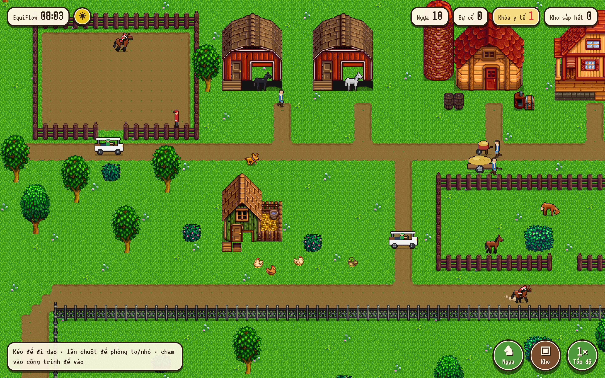
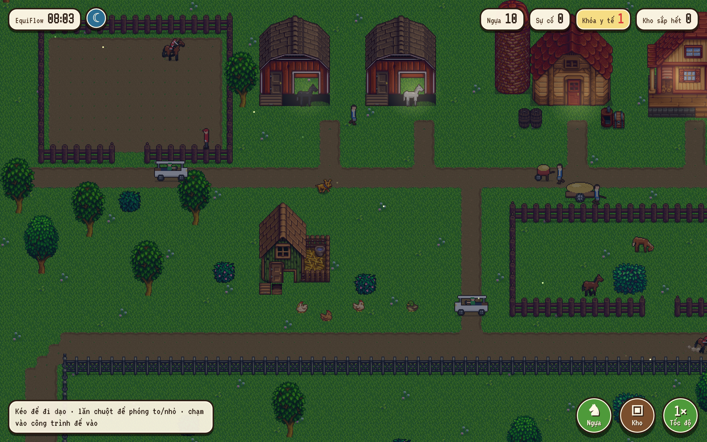
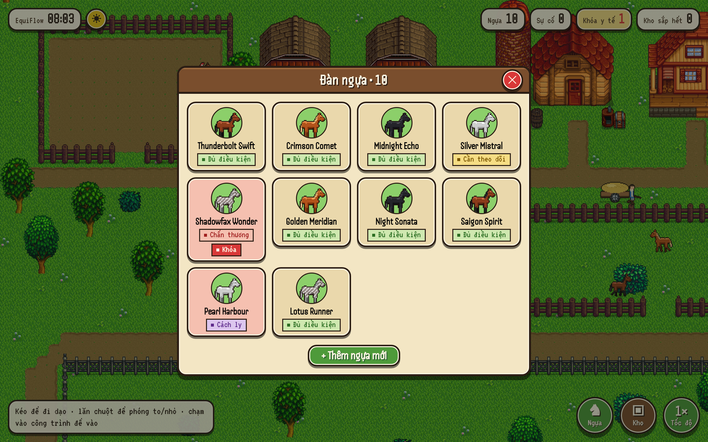
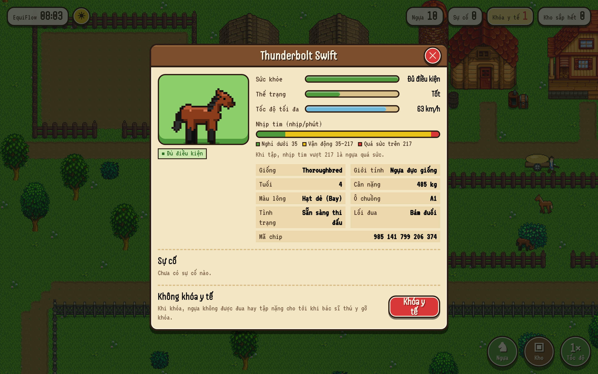
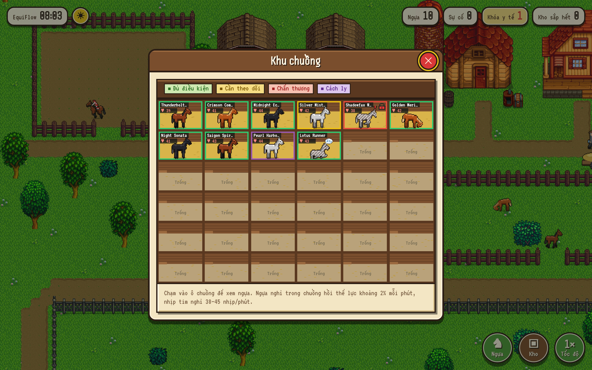
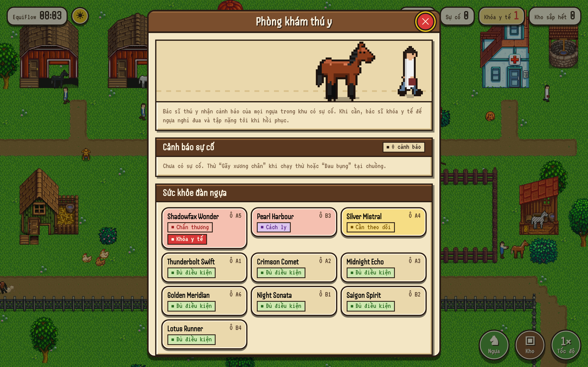
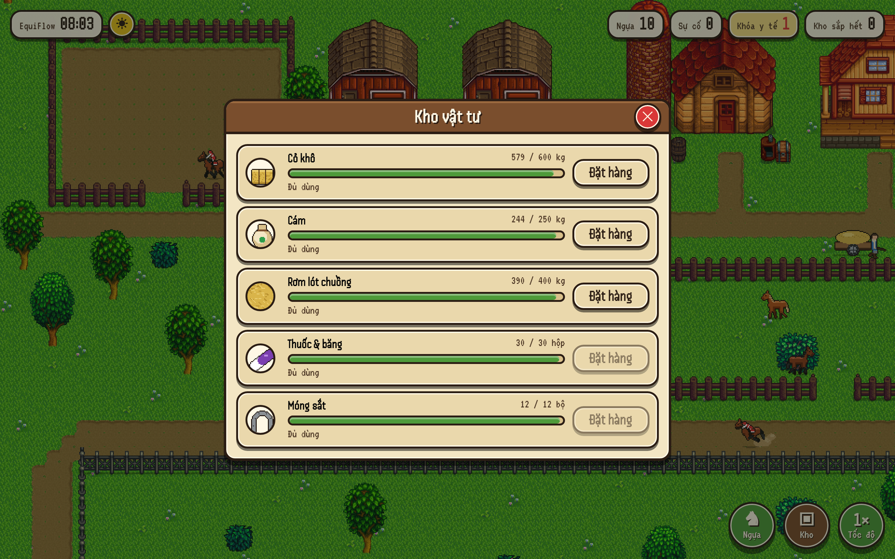
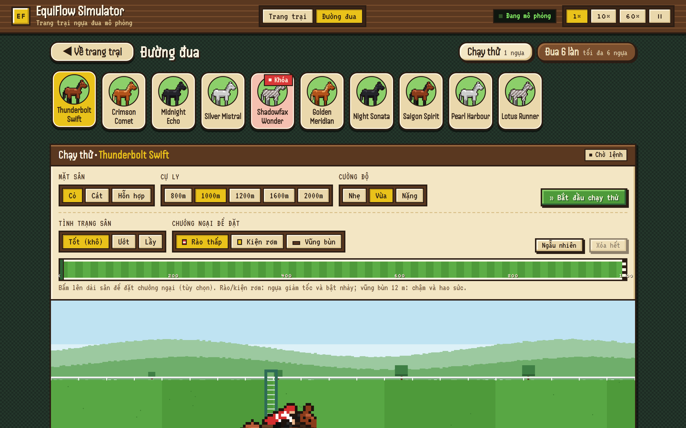
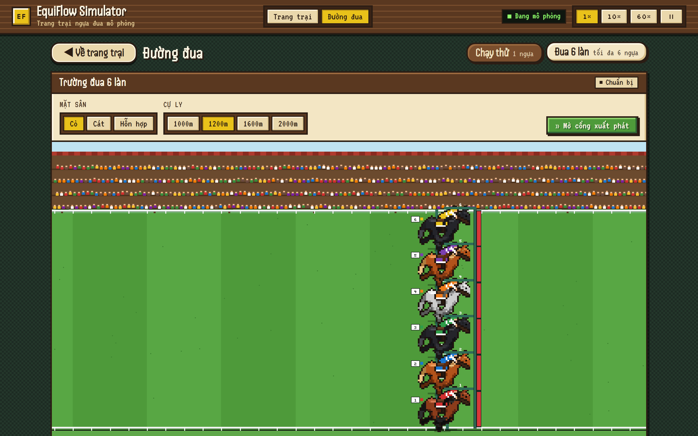

# 🐎 EquiFlow Simulator Web — Phiên Bản 2 (v2: Stardew Valley Farm Edition)

[](https://github.com/MichaelTran1226/Racehorse_Simulator_Web/releases/tag/v2.0.0)
[](https://github.com/MichaelTran1226/Racehorse_Simulator_Web/tree/v2-stardew-valley)
[](https://github.com/MichaelTran1226/Racehorse_Simulator_Web)
[](https://github.com/MichaelTran1226/Racehorse_Simulator_Web)

> **Phân hệ 1 theo SRS & Design Handoff v2.0** (`horse simulation model/`).  
> Ứng dụng web độc lập, đồ họa **Pixel Art trên HTML5 Canvas 2D phong cách Stardew Valley**, kết hợp giao diện tương tác **Hay Day** thân thiện với người dùng.  
> Tích hợp bản đồ nông trại mùa xuân bố cục B, động cơ mô phỏng sinh trắc học ngựa (Telemetry Math Engine), quản lý kho vật tư, khu chuồng trại, trạm thú y và trường đua kịch tính.

---

> [!NOTE]
> **Bạn đang xem Phiên Bản 2 (v2.0.0 — Stardew Valley Edition):**
> - **Mã nguồn:** Nền bản đồ thế giới 1280×768 (ô 16px) được ghép từ 16 bộ tileset gốc ConcernedApe từ Stardew Valley (`Flooring`, `Town`, `Barn`, `Shed`, `Silo`, `Houses`, ...).
> - **Autotile 4×4:** Đất nện và đường đi tự động tính toán 16 trạng thái lân cận mượt mà từ `Flooring.png`.
> - **Sinh vật môi trường:** Đàn gia cầm & thú cưng Stardew di chuyển sống động: gà trắng, gà nâu, vịt, chó cưng và mèo mướp (thay thế S16).
> - **Hệ thống Anchors:** Tọa độ cửa công trình và 3 vị trí ngựa đứng trong chuồng được chuẩn hóa nguồn dữ liệu duy nhất (`anchors`).
> - **Động cơ Telemetry:** Kế thừa trọn vẹn từ v1 (nhịp tim 3 vùng, mã chip 15 số ISO 11784/11785, quản lý thể lực, bề mặt sân, chướng ngại vật).
> - **Chuyển sang Phiên bản 1 (Bản gốc Pixel-Art):** Xem nhánh [`v1`](https://github.com/MichaelTran1226/Racehorse_Simulator_Web/tree/v1) hoặc đọc [VERSIONS.md](VERSIONS.md).

---

## 📸 Showcase Giao Diện Thực Tế (v2 Visual Showcase)

### 1. Bản Đồ Trang Trại Stardew Valley (Bố Cục B Mùa Xuân) — Ngày & Đêm
Toàn cảnh trang trại 1280×768 mang âm hưởng đồng quê thung lũng Stardew: thảm cỏ hoa mùa xuân xanh ngát, 2 chuồng Barn gỗ sồi, cụm kho Silo và Shed kiên cố, phòng khám thú y Harvey và nhà lớn 2 tầng cho NPC sinh hoạt. Camera kéo thả mượt mà với quán tính vật lý và lăn chuột zoom tự do quanh con trỏ.

| ☀ Toàn cảnh ban ngày Stardew (Day Mode) | ☾ Ánh đèn & đom đóm ban đêm (Night Mode) |
|:---:|:---:|
|  |  |
| *Bố cục B mùa xuân: 2 Barns, Silo + Shed, phòng khám Harvey, đàn gà vịt đi dạo, chó vẫy đuôi, HUD 4 góc* | *Hiệu ứng ban đêm huyền ảo, ánh sáng vàng hắt từ các khung cửa gỗ Stardew, đom đóm lập lòe* |

---

### 2. Thẻ Theo Dõi Chiến Mã (Telemetry) & Quản Lý Đàn Ngựa
Chạm trực tiếp vào bất kỳ chú ngựa nào trên bãi cỏ hoặc bấm nút tròn **♞ Ngựa** ở góc phải dưới để mở bảng danh mục đàn ngựa và thẻ chiến mã chi tiết.

| 📋 Danh sách đàn ngựa (Horse Roster) | 🩺 Thẻ Telemetry chi tiết (Horse Card) |
|:---:|:---:|
|  |  |
| *Lưới thẻ chiến mã với avatar pixel art, tình trạng sức khỏe (Đủ điều kiện, Cần theo dõi, Khóa)* | *Chân dung hoạt ảnh, thanh đo nhịp tim (BPM) 3 dải màu, thể lực, tốc độ km/h, mã chip 15 số ISO và nút bật/tắt Khóa y tế* |

---

### 3. Khu Chuồng Trại & Trạm Thú Y (Stalls & Vet Clinic)
Bấm vào công trình trên bản đồ: camera lướt tới vị trí công trình và mở bảng nổi gỗ phong cách Hay Day.

| 🏠 Khu chuồng trại (6×6 Stalls Grid) | 🏥 Trạm khám thú y (Vet Clinic) |
|:---:|:---:|
|  |  |
| *Phân bổ ngựa vào các ô chuồng nghỉ ngơi; mã màu phân loại thể trạng; ngựa ngủ có bong bóng "zzz"* | *Khu cách ly theo dõi chấn thương, bảng cảnh báo sự cố thời gian thực và quản lý khóa y tế* |

---

### 4. Bảng Quản Lý Kho Vật Tư & Xe Giao Hàng (Supply Barn)
Mô phỏng tiêu hao tài nguyên (cỏ khô, yến mạch, rơm lót chuồng, thuốc men, móng sắt) theo số lượng ngựa và thời gian mô phỏng. Khi đặt hàng, xe tải sẽ lăn bánh từ cổng vào tận cửa kho để bốc dỡ hàng.

<p align="center">
  
  <br />
  <em>Bảng theo dõi định mức tồn kho, cảnh báo khi sắp cạn và nút Đặt hàng gọi xe tải giao tận nơi</em>
</p>

---

### 5. Khu Vực Đường Đua (Track Arena) — Chạy Thử & Đua 6 Làn
Đường đua là phân hệ mô phỏng vận động chuyên sâu với 2 chế độ: **Chạy thử 1 ngựa** và **Đua 6 làn**.

| ⏱ Chế độ Chạy thử (Trial Simulation) | 🏁 Trường đua 6 làn (6-Lanes Race) |
|:---:|:---:|
|  |  |
| *Tùy chọn cự ly (800m - 2000m), mặt sân (Cỏ/Cát/Hỗn hợp), tình trạng (Khô/Lầy) và đặt rào cản* | *Khán đài sôi động, 6 nài ngựa trong trang phục thi đấu tại cổng xuất phát, tính toán thứ hạng theo thời gian thực* |

---

## 🌾 Tài Nguyên Đồ Họa Stardew Valley (v2 Curated Assets)

Toàn bộ đồ họa nền được chép nguyên byte từ các bộ sprite gốc của ConcernedApe và ghép theo quy chuẩn kiểm định nghiêm ngặt:

| Sheet Stardew | Kích thước | Vai trò trong Bản Đồ v2 |
|---|---|---|
| `sv-spring-outdoors` | 400×1264 px | Nền cỏ mùa xuân, bụi hoa dại, thềm đất tự nhiên |
| `sv-flooring` | 256×256 px | Nguồn gạch lát đường và bãi cát cho thuật toán autotile 4×4 |
| `sv-barn` | 112×128 px | 2 dãy chuồng ngựa lớn (Khu chuồng trại chính) |
| `sv-shed` | 112×128 px | Nhà kho phụ kiện & dụng cụ chăm sóc |
| `sv-silo` | 48×128 px | Tháp dự trữ cỏ khô & yến mạch |
| `sv-houses` | 272×432 px | Nhà lớn 2 tầng cho quản lý & chủ ngựa ra vào |
| `sv-spring-town` | 512×992 px | Phòng khám thú y Harvey Clinic |
| `sv-tree1-spring`, `sv-tree2-spring` | 48×160 px | Hàng cây sồi mùa xuân che bóng mát |
| `sv-fence-wood`, `sv-fence-iron` | 48×192 px | Hàng rào gỗ bãi thả và rào sắt bao quanh |
| `sv-craftables` | 128×736 px | Thùng gỗ, rương đồ, bao cám trang trí khu kho |

### Sinh vật môi trường Stardew (Critters Runtime):
- 🐔 **White Chicken / Brown Chicken**: Đi dạo gặm thóc quanh khu kho.
- 🦆 **Duck**: Thong thả bơi lội và đi dạo bãi cỏ.
- 🐕 **Dog**: Chó cưng vẫy đuôi, đứng canh cổng bãi thả.
- 🐱 **Cat**: Mèo mướp lười biếng nằm sưởi nắng trước hiên nhà.

---

## 🧪 Kiểm Thử & Đảm Bảo Chất Lượng (Quality Gates)

Phiên bản v2 bổ sung kiểm thử cho autotile, tính toàn vẹn byte của 16 sheet Stardew và hệ thống anchors:

- `npm run typecheck`: **0 lỗi TypeScript** (chế độ strict).
- `npm test`: **79/79 bài kiểm thử tự động đạt 100%**.
- `npm run build`: Tạo bundle production tối ưu (`dist/`).

```bash
# Khởi chạy kiểm thử
npm test

# Khởi chạy server phát triển
npm run dev
```

---

## 🧭 Điều Hướng Giữa Các Phiên Bản

| Phiên bản | Nhánh | Lệnh chuyển nhanh |
|---|---|---|
| **Bản v1 (Original Pixel-Art)** | `v1` | `git checkout v1` |
| **Bản v2 (Hiện tại)** | `v2-stardew-valley` | `git checkout v2-stardew-valley` |
| **Tài liệu so sánh** | `main` | Xem tệp [VERSIONS.md](VERSIONS.md) |
